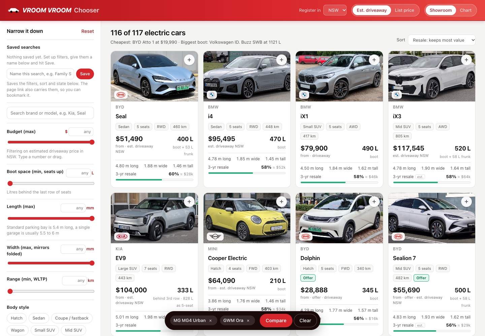
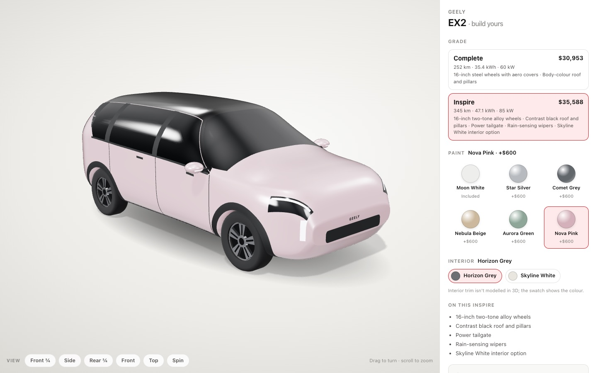
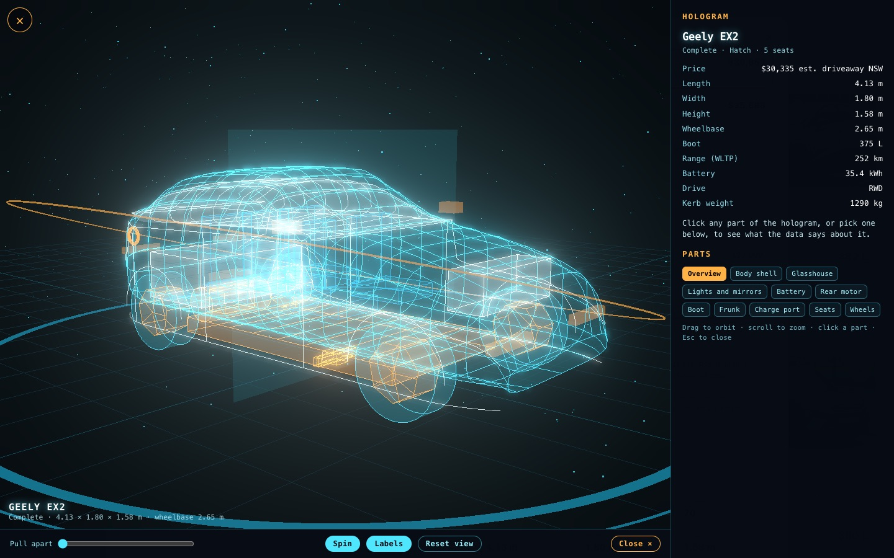

# Vroom Vroom Chooser

Every battery-electric car on sale in Australia (October 2026) in one showroom, built to answer two questions first: **what does it cost to put on the road, and how big is it**, especially the boot.

**Live site: https://brendonlow.github.io/vroom-vroom/**



## What it does

- **Showroom** of 117 models from 41 brands. Each card shows the cheapest variant that passes your filters, its boot space, size and 3-year resale value. Tap the **+** in a card's top-right corner to add it to the compare list.
- **Filters**: budget, minimum boot, maximum length and width, minimum range, body style, seats, drive, brand origin (Chinese or non-Chinese, optionally counting Geely-owned Volvo, Polestar and Lotus as Chinese) and individual brands. Every slider has a number box, and there's a brand/model search.
- **Prices your way**: estimated driveaway price for your state (stamp duty, rego/CTP and dealer delivery), or list price before on-road costs. Live October 2026 offers are used as the price and tagged "Offer". Got a dealer quote? Type it in and it replaces the estimate everywhere.
- **Car detail and configurator**: pick a variant and paint and see the price breakdown. Tabs show a to-scale footprint against a familiar petrol car and a 5.4 m parking bay, the boot against a Toyota RAV4 with suitcase counts, and the closest-sized rivals.
- **Resale value**: the average share of the new price kept after 3 years (~45,000 km), what that's worth in dollars, and the 3-year depreciation including on-road costs. Figures marked "est." are for models too new to have Australian used-market data.
- **Compare** up to four cars side by side, with the best value in each row highlighted.
- **Chart** of price against boot space, length, range or resale value.
- **Saved searches**, kept in your browser. The page link also carries your filters, so a bookmark reopens the same view.
- **3D hologram** (Iron Man style) on a few cars: a wireframe built from the car's real dimensions, battery, drive layout, seats and boot. Orbit it, pull it apart, and tap a part to see its data.
- **3D paint configurator** for the Geely EX2: a painted model you can spin, with the six Australian colours, both grades (different wheels and roof) and the interior trims, priced as you go.
- **Works on phones**, including the 3D views. The back button closes whatever is open.





## Run it locally

No build step and no dependencies. Serve the folder over http (the 3D views use ES modules, which don't load from `file://`):

```
python3 serve.py 8097
```

then open http://localhost:8097. Any static server works; `serve.py` just adds a `Cache-Control: no-cache` header so phones pick up changes.

## Data and caveats

- **`data.js`** holds the cars, state on-road cost rules, paint palettes and brand origins. Prices are manufacturer list prices or brand-quoted driveaway prices, dated per model (`asOf`). Dimensions and boot volumes are each brand's published figures; boot litres are VDA where published, and Tesla and Cadillac figures are flagged as not comparable. Paint surcharges are indicative, and stamp duty rules are simplified.
- **`resale.js`** holds the resale figures. 44 of the 117 come from Australian used listings and price guides; the rest are estimated from the brand and segment. Each entry has a one-line note and its sources.
- Models announced but not deliverable in October 2026 are left out.
- Prices, offers and resale values go stale quickly. **Check with a dealer before you buy.**

To update a price, edit the variant in `data.js`.

## Credits

- Car photos come from Wikipedia and Wikimedia Commons under their Creative Commons licences. Each car's detail view credits its photo, and `img/credits.json` lists them all.
- Brand logos come from Wikimedia Commons and remain trademarks of their owners.
- 3D rendering uses [three.js](https://threejs.org), vendored in `vendor/` (MIT licence).

This is an independent hobby project with no affiliation with any car brand or dealer.
